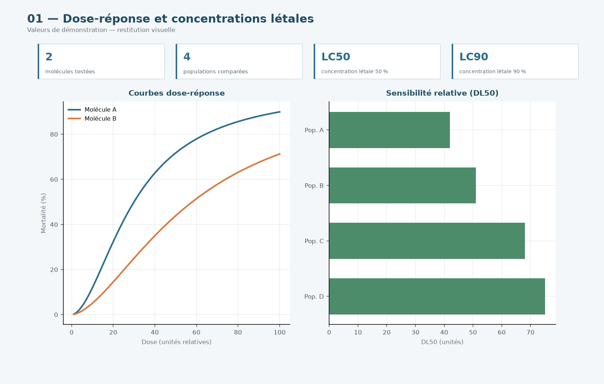

> **Besoin** : Estimer et comparer les concentrations létales (LC50, LC90) de populations de tiques testées face à deux molécules acaricides (alphacyperméthrine et amitraz), afin de caractériser leur niveau de sensibilité.  
> **Décision éclairée** : Classer les populations testées par sensibilité et orienter les stratégies de traitement et de surveillance.

| | |
|---|---|
| **Domaine** | biostatistique, résistance aux acaricides |
| **Échantillon** | Essais biologiques en concentration croissante (données confidentielles) |
| **Outils** | R 4.6.0 (`readxl`, `dplyr`, `tidyr`, `openxlsx`, `officer`, `flextable`) |
| **Méthodes clés** | Régression binomiale, estimation LC50/LC90, comparaison de sensibilité |

::: {.brief}
**En bref**

- **Question** : Estimer et comparer les concentrations létales (LC50, LC90) de populations de tiques testées face à deux molécules acaricides (alphacyperméthrine et amitraz), afin de caractériser leur niveau de sensibilité.
- **Méthodes** : Régression binomiale, estimation LC50/LC90, comparaison de sensibilité
- **Livrable** : Rapport détaillé anonymisé et tableau de bord
- **Résultat clé** : Des concentrations létales ont été estimées pour les deux molécules testées et pour chacune des populations.
:::

## Données

Données de mortalité issues d'essais biologiques en concentration croissante, structurées en format long (dose, nombre d'individus testés, nombre de mortalités, population, molécule). Les données brutes sont confidentielles et ne sont pas publiées ici.

## Démarche statistique

1. **Préparation** : importation des fichiers Excel, mise en forme et nettoyage, passage au format long adapté aux modèles binomials.
2. **Modélisation** : régression logistique binomiale de la probabilité de mortalité en fonction de la dose, avec estimation des paramètres du modèle dose-réponse.
3. **Estimation des concentrations létales** : calcul des doses produisant 50 % et 90 % de mortalité (LC50 / LC90) pour chaque population et chaque molécule.
4. **Comparaison** : lecture des estimations et de leurs intervalles pour apprécier les différences de sensibilité entre populations.
5. **Restitution** : export des résultats sous forme de tableaux formatés pour un rapport scientifique.

## Résultats

- Des concentrations létales ont été estimées pour les deux molécules testées et pour chacune des populations.
- La comparaison des LC50/LC90 met en évidence des niveaux de sensibilité différents selon les populations, information utile pour la gestion de la résistance.
- Les tableaux de concentrations létales ont été intégrés au rapport d'analyse avec leurs intervalles de confiance.

*Les valeurs numériques précises et les courbes dose-réponse ne sont pas publiées ici (données de travail confidentielles).*

## Limites

- Valeurs précises et courbes réelles non publiées ; comparaison limitée aux molécules et populations testées.

## Interprétation

L'approche par régression binomiale permet de passer d'observations de mortalité brutales à une **relation dose-effet continue**, et donc de comparer des populations sur une échelle commune. Elle fournit des indicateurs directement exploitables (LC50, LC90) pour recommander des stratégies de traitement ou de surveillance.

  ← Première étude
  <a href="../../etudes.qmd">Retour à la liste</a>
  <a href="../02-indices-ethnobotaniques/index.qmd">Étude suivante</a> →

