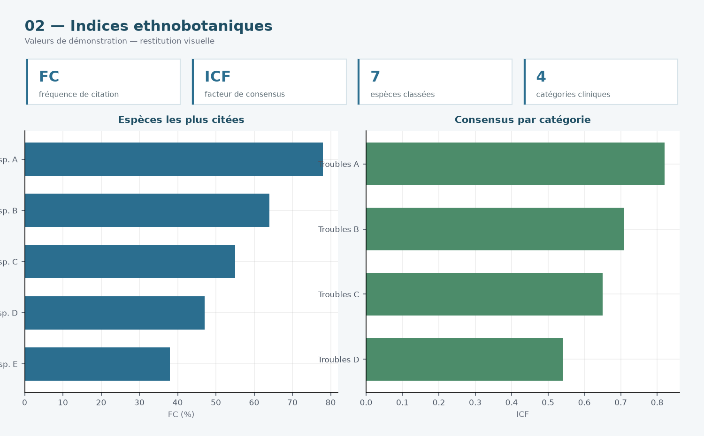

> **Besoin** : Comment quantifier l'usage des plantes médicinales à partir d'un enquête auprès d'informatrices : quelles espèces sont les plus citées, et existe-t-il un consensus sur les plantes utilisées selon les catégories de symptômes ?  
> **Décision éclairée** : Identifier les espèces prioritaires et les catégories de symptômes faisant l'objet d'un savoir partagé.

| | |
|---|---|
| **Domaine** | ethnobotanique, statistiques descriptives |
| **Échantillon** | Enquête auprès d'informatrices (données anonymisées) |
| **Outils** | Excel, R |
| **Méthodes clés** | Statistiques descriptives, fréquence de citation (FC), facteur de consensus (ICF) |

## Données

Données d'enquête anonymisées : citations d'espèces végétales, catégories de symptômes, profil des informatrices. Les données brutes ne sont pas publiées dans ce dépôt.

## Démarche statistique

1. **Statistiques descriptives** : répartition des informatrices selon le recours aux plantes médicinales, effectifs et fréquences.
2. **Fréquence de citation (FC)** : classement des espèces les plus citées par les participants.
3. **Facteur de consensus des informateurs (ICF)** : mesure du degré d'accord entre les répondants pour chaque catégorie de symptôme.
4. **Standardisation des symptômes** : regroupement des réponses en catégories comparables avant calcul des indices.
5. **Restitution graphique** : figures de répartition et de classement intégrées au rapport.

## Résultats

- Une hiérarchie des espèces les plus citées a été établie (FC), permettant d'identifier les plantes les plus utilisées.
- L'ICF a été calculé par catégorie de symptôme et classé par ordre décroissant, mettant en évidence les domaines d'usage où le consensus est le plus fort.
- La répartition des informatrices selon le recours aux plantes médicinales a été décrite.

*Les figures et les tableaux détaillés ne sont pas publiés ici (données de travail confidentielles).*

## Limites

- Figures et tableaux détaillés non publiés ; les indices dépendent du nombre de répondants et de citations.

## Interprétation

Les indices ethnobotaniques transforment des citations qualitatives en **indicateurs comparables**. La fréquence de citation met en évidence les espèces les plus présentes dans la pratique, tandis que l'ICF révèle les syndromes pour lesquels les savoirs sont les plus partagés — deux informations complémentaires pour prioriser des études pharmacologiques ou de conservation.
