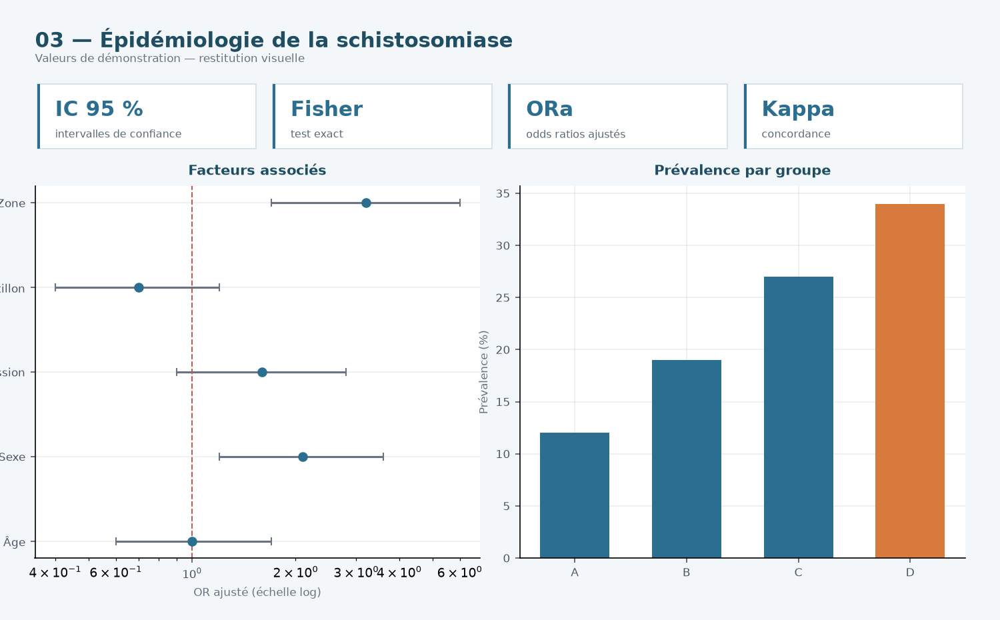

> **Besoin** : Décrire le profil de l'échantillon et les déterminants de l'infection, puis évaluer la performance d'une méthode de diagnostic (Mini-FLOTAC) par rapport à une méthode de référence (test d'éclosion).  
> **Décision éclairée** : Décrire l'infection, identifier les facteurs associés et évaluer la méthode de diagnostic Mini-FLOTAC.

| | |
|---|---|
| **Domaine** | épidémiologie, santé publique |
| **Échantillon** | Base structurée : variables sociodémographiques, cliniques et malacologiques |
| **Outils** | R 4.6.0, package `epiR` |
| **Méthodes clés** | Prévalence, IC 95 %, Fisher, OR ajustés, Kappa, sensibilité/spécificité |

## Données

Base structurée sous Excel comprenant des variables sociodémographiques (sexe, classe d'âge, profession), cliniques (type d'échantillon, statut biologique, intensité de l'infection) et malacologiques (espèces, échelle mensuelle et saisonnière). Données confidentielles, non publiées ici.

## Démarche statistique

1. **Description** : effectifs (N), fréquences (%) et intervalles de confiance à 95 % (IC 95 %) pour les variables qualitatives.
2. **Charge parasitaire** : moyenne, médiane, minimum et maximum des œufs/10 mL chez les cas positifs.
3. **Associations** : test exact de Fisher pour les variables catégorielles, seuil de significativité p < 0,05 ; force des liaisons par odds ratios ajustés (ORa, IC 95 %), avec correction empirique de Haldane-Anscombe pour les modalités à 100 % d'infection.
4. **Suivi médical** : comparaison des taux de positivité et des niveaux d'intensité selon le schéma thérapeutique (non traité versus traitement annuel).
5. **Performance diagnostique** : tableau de contingence 2 × 2 (positif si EPG > 0 pour Mini-FLOTAC), sensibilité, spécificité, valeurs prédictives positive et négative, exactitude, avec IC exacts de Clopper-Pearson.
6. **Concordance** : coefficient Kappa de Cohen (IC 95 % selon Fleiss), complété par un intervalle bootstrap (5 000 rééchantillonnages) ; biais systématique testé par le test de McNemar exact. Calculs vérifiés avec `epiR`.

## Résultats

- Le profil de l'échantillon a été décrit par des fréquences et IC 95 % pour l'ensemble des variables sociodémographiques, cliniques et malacologiques.
- Les associations entre caractéristiques des participants et infection ont été quantifiées par ORa, permettant d'identifier les facteurs liés à l'infection.
- La concordance entre Mini-FLOTAC et la méthode de référence a été mesurée par Kappa, avec recherche d'un éventuel biais systématique.

*Les valeurs précises, tableaux de contingence et courbes ne sont pas publiés ici (données de travail confidentielles).*

## Limites

- Faibles effectifs sur certaines modalités ; valeurs et tableaux de contingence non publiés.

## Interprétation

Cette analyse combine **description, recherche de déterminants et validation d'outil diagnostique**. L'utilisation de tests exacts et de méthodes de bootstrap tient compte des faibles effectifs, tandis que les OR ajustés permettent de distinguer les associations indépendantes. Elle illustre un pipeline complet d'analyse épidémiologique, de la donnée brute à la décision de santé publique.
