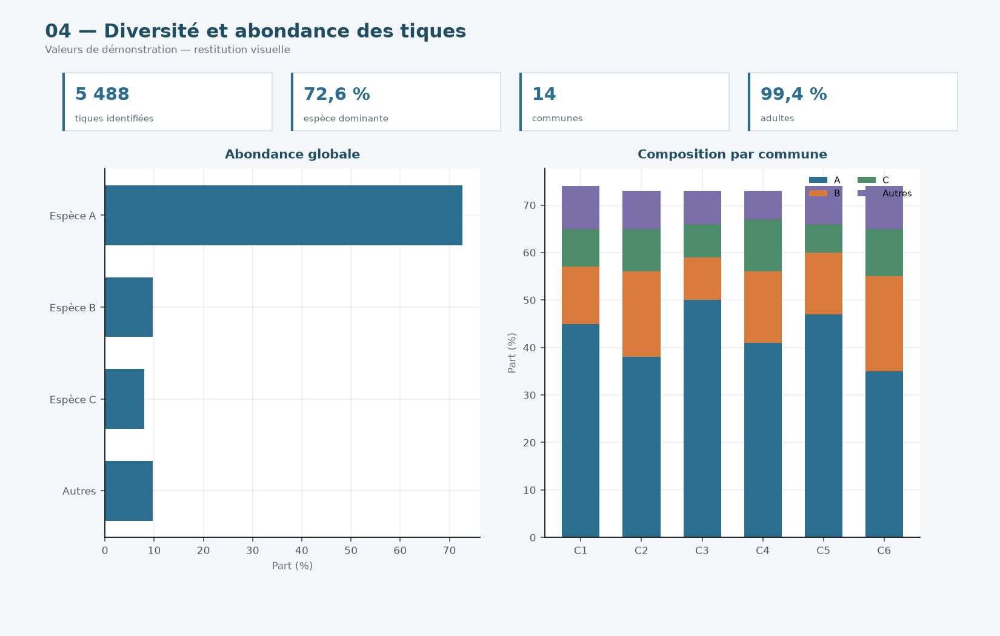

> **Besoin** : Quelle est la composition spécifique des tiques collectées sur les bovins dans 14 communes, et comment la diversité et l'abondance varient-elles selon la localisation, l'âge et le sexe des animaux ?  
> **Décision éclairée** : Cibler les zones de surveillance et les espèces à prioriser dans la lutte antitique.

| | |
|---|---|
| **Domaine** | entomologie vétérinaire, épidémiologie |
| **Échantillon** | 5 488 tiques identifiées sur 1 952 bovins, 14 communes |
| **Outils** | Excel, STATISTICA |
| **Méthodes clés** | Jaccard, χ², prévalence, charge parasitaire |

## Données

5 488 tiques identifiées sur 1 952 bovins, réparties en 14 communes. Données de terrain confidentielles, non publiées ici.

## Démarche statistique

1. Description des effectifs, fréquences et prévalences d'infestation.
2. Comparaison de la composition spécifique des sites par l'indice de similarité de Jaccard.
3. Analyse de la répartition selon le stade de développement et le sexe des tiques par test χ² d'indépendance.
4. Comparaison des taux d'infestation selon l'âge et le sexe des bovins.

## Résultats

- *Rhipicephalus microplus* domine largement (72,59 % des tiques), devant *Amblyomma variegatum* (9,68 %) et *R. decoloratus* (8,02 %).
- La prévalence d'infestation varie de 0,18 % à 68,03 % selon l'espèce ; *R. microplus* présente la plus forte prévalence.
- Les adultes représentent 99,40 % des tiques collectées, avec une nette dominance de femelles (90,16 %, p < 0,001).
- La charge parasitaire diffère significativement entre adultes et veaux (p < 0,001) et entre sexes (p < 0,001).
- L'indice de Jaccard (0,5 à 1) indique une forte similarité de composition entre communes, avec une homogénéité parfaite pour deux d'entre elles.

*Les tableaux détaillés et les cartes ne sont pas publiés ici.*

## Limites

- Cartes et tableaux détaillés non publiés ; effort d'échantillonnage variable selon les communes.

## Interprétation

La combinaison des indices de similarité et des tests de contingence permet de distinguer **homogénéité des espèces présentes** et **hétérogénéité des abondances**, information utile pour cibler les zones de surveillance et les stratégies de lutte contre les tiques.
