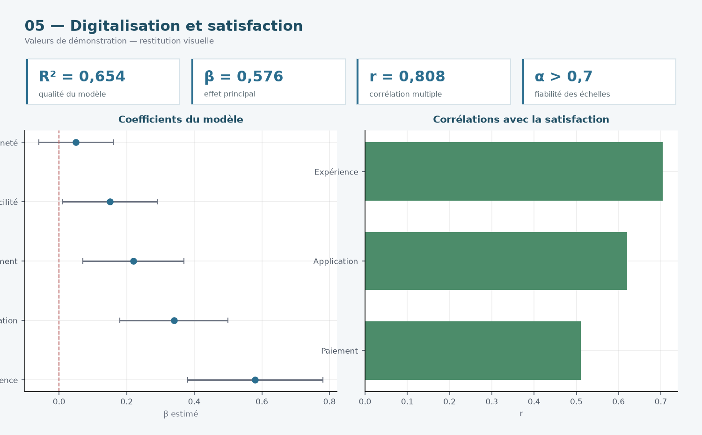

> **Besoin** : Comment l'adoption des services digitaux et l'expérience digitale influencent-elles la satisfaction des clients d'une banque ?  
> **Décision éclairée** : Prioriser les leviers digitaux ayant le plus d'effet sur la satisfaction.

| | |
|---|---|
| **Domaine** | enquête de satisfaction, statistiques appliquées au marketing |
| **Échantillon** | Questionnaires anonymisés, échelles de Likert |
| **Outils** | Excel, SPSS |
| **Méthodes clés** | Alpha de Cronbach, corrélation, régression linéaire |

## Données

Données d'enquête anonymisées issues de questionnaires (échelles de Likert). Les données brutes ne sont pas publiées.

## Démarche statistique

1. Vérification de la cohérence interne des échelles par l'alpha de Cronbach.
2. Statistiques descriptives des réponses.
3. Matrice de corrélation entre variables indépendantes et satisfaction.
4. Régression linéaire multiple expliquant la satisfaction.

## Résultats

- Tous les alpha de Cronbach sont supérieurs à 0,7 : bonne fiabilité des échelles.
- Les réponses moyennes se situent entre 3 (indifférent) et 5 (tout à fait d'accord).
- L'adoption de l'application mobile, l'adoption du service de paiement mobile et l'expérience digitale sont corrélées positivement à la satisfaction (r > 0,5 ; p < 0,05).
- L'expérience client digitale présente l'effet le plus fort (β = 0,576 ; p = 0,0002) ; l'adoption de l'application mobile est également liée à la satisfaction (r = 0,704).
- Le modèle global est significatif (r = 0,808 ; R² = 0,654).

*Les coefficients détaillés et les tableaux ne sont pas publiés ici.*

## Limites

- Coefficients détaillés non publiés ; étude transversale, causalité non démontrée.

## Interprétation

La démarche montre un enchaînement complet : **validation des échelles → exploration des corrélations → modélisation**. Elle permet de quantifier le poids relatif de chaque levier digital sur la satisfaction et d'orienter les recommandations opérationnelles.
