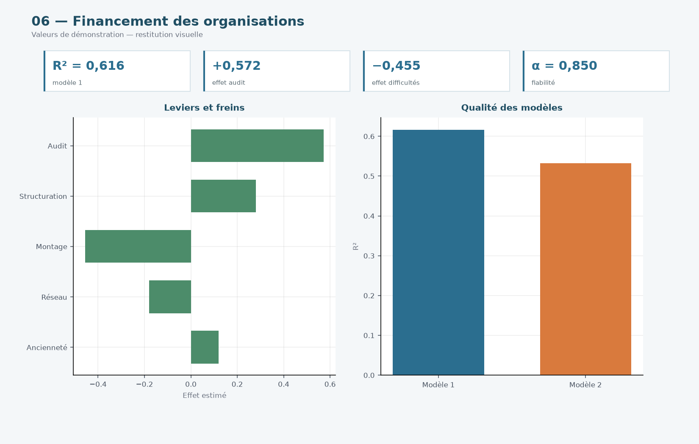

> **Besoin** : Quels facteurs internes et externes facilitent ou limitent l'accès au financement des organisations féministes, et comment les sources de financement sont-elles perçues par les bailleurs ?  
> **Décision éclairée** : Renforcer l'accès des organisations au financement en agissant sur les leviers identifiés.

| | |
|---|---|
| **Domaine** | enquête institutionnelle, économie et statistiques sociales |
| **Échantillon** | Enquête auprès de bailleurs et de structures |
| **Outils** | Excel, SPSS |
| **Méthodes clés** | Fiabilité des échelles, corrélations, régression linéaire |

## Données

Données d'enquête anonymisées auprès de bailleurs et de structures (échelles de Likert, items multiples). Non publiées ici.

## Démarche statistique

1. Test de fiabilité des échelles (alpha de Cronbach).
2. Analyse descriptive des réponses et des sources de financement.
3. Matrice de corrélation entre contraintes internes/externes et accès au financement.
4. Deux modèles de régression linéaire (variables dépendantes : deux dimensions de l'accès au financement).

## Résultats

- Bonne consistance interne des échelles (α = 0,850 et 0,772).
- La réalisation d'un audit favorise l'obtention régulière de financements, tandis que le manque de structuration institutionnelle est perçu comme un frein majeur.
- Certaines sources internationales sont peu utilisées selon les répondants (réponses moyennes entre 1,77 et 2,67 sur une échelle à 4 modalités).
- La réalisation d'un audit a un effet significatif positif (β = 0,572 ; p = 0,0006), alors que les difficultés de montage de projets ont un effet négatif (β = -0,455 ; p = 0,0131).
- Qualité des modèles : r = 0,785 (R² = 0,616) et r = 0,730 (R² = 0,532).

*Les tableaux détaillés ne sont pas publiés ici.*

## Limites

- Tableaux détaillés non publiés ; déclarations subjectives des répondants.

## Interprétation

L'analyse combines descriptive et modélisation pour séparer les **leviers organisationnels** (audit, structuration) des **contraintes opérationnelles**. Elle fournit des pistes concrètes pour renforcer l'accès des structures aux financements.
