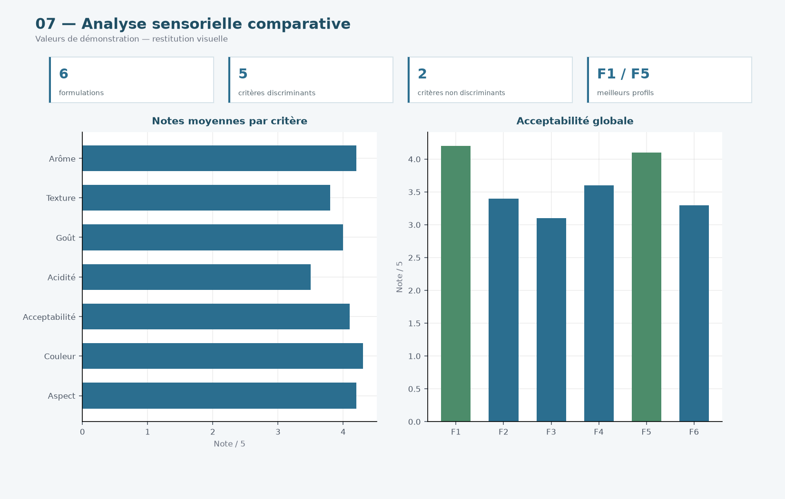

> **Besoin** : Parmi six formulations alimentaires, lesquelles présentent les meilleures propriétés sensorielles, et quels critères discriminent réellement les échantillons ?  
> **Décision éclairée** : Retenir les formulations présentant les meilleurs profils sensoriels et écarter les critères peu discriminants.

| | |
|---|---|
| **Domaine** | analyse sensorielle, statistiques non paramétriques |
| **Échantillon** | Six formulations, notations multi-critères |
| **Outils** | STATISTICA |
| **Méthodes clés** | Kruskal-Wallis, Dwass-Steel-Critchlow-Fligner, ACP |

## Données

Notes sensorielles attribuées à six échantillons selon plusieurs critères (couleur, aspect, arôme, texture, goût, acidité, acceptabilité globale). Données de test non publiées ici.

## Démarche statistique

1. Test de normalité : aucune variable ne suit une distribution normale (p < 0,05).
2. ANOVA de Kruskal-Wallis pour comparer les échantillons critère par critère.
3. Comparaisons pair-à-pair de Dwass-Steel-Critchlow-Fligner.
4. Analyse en composantes principales (ACP) pour visualiser la proximité entre échantillons et critères.

## Résultats

- Seuls les critères arôme, texture, goût, acidité et acceptabilité diffèrent significativement entre échantillons (p < 0,05).
- La couleur et l'aspect ne permettent pas de différencier les formulations (p > 0,05).
- Deux formulations (F1 et F5) présentent les meilleures caractéristiques globales sur le plan factoriel.
- Les critères aspect et couleur, proches de l'origine dans le biplot, sont peu discriminants.

*Figures et tableaux de notes détaillés non publiés ici.*

## Limites

- Notes détaillées non publiées ; panel de dégustation de taille limitée.

## Interprétation

Le choix de tests non paramétriques, imposé par la non-normalité, est complété par une ACP qui synthétise les profils sensoriels. Cette combinaison permet de **réduire un grand nombre de critères à une recommandation de formulation** lisible.
