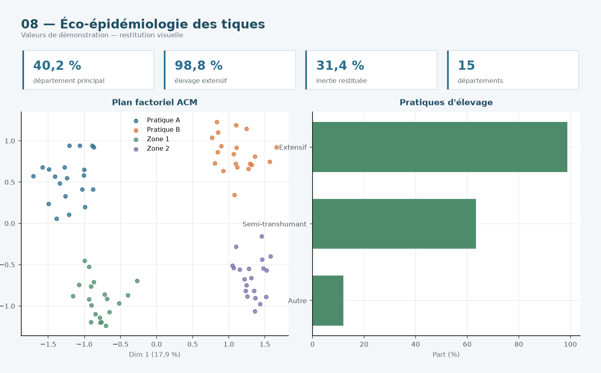

> **Besoin** : Quelles sont les caractéristiques socio-économiques et les pratiques d'élevage des répondants, et comment ces variables structurent-elles la présence des tiques ?  
> **Décision éclairée** : Cibler les groupes de pratiques à risque et adapter les messages de sensibilisation.

| | |
|---|---|
| **Domaine** | épidémiologie, enquête de terrain |
| **Échantillon** | Enquête de terrain, quinze départements |
| **Outils** | KoboToolbox, Excel, STATISTICA |
| **Méthodes clés** | IC 95 %, ACM, inertie |

## Données

Données d'enquête collectées avec KoboToolbox, codées et exploitées sous Excel. Quinze départements représentés ; données confidentielles.

## Démarche statistique

1. Calcul des fréquences avec intervalles de confiance à 95 %.
2. Description du profil des répondants (sexe, âge, activité, pratiques d'élevage).
3. Analyse des correspondances multiples (ACM) pour explorer les associations entre modalités.
4. Interprétation des dimensions principales (valeurs propres, inertie expliquée).

## Résultats

- Un département concentre 40,24 % des répondants ; 91,46 % sont des hommes, avec une majorité de 21 à 45 ans (67,07 %).
- L'élevage extensif est quasiment généralisé (98,78 %) et le mode semi-transhumant dominant (63,41 %).
- L'ACM montre que les deux premières dimensions restituent 31,42 % de l'inertie totale ; la première dimension explique 17,86 % de l'inertie.
- Le plan factoriel met en évidence une faible maîtrise du mode d'emploi des acaricides et des pratiques de compartimentage des troupeaux.

*Cartes et tableaux détaillés non publiés ici.*

## Limites

- Cartes et tableaux non publiés ; l'ACM reste une méthode descriptive.

## Interprétation

L'ACM permet de résumer un grand tableau de contingence en quelques axes interprétables. Elle révèle des **groupes de pratiques à risque** et aide à cibler les messages de sensibilisation des éleveurs.
