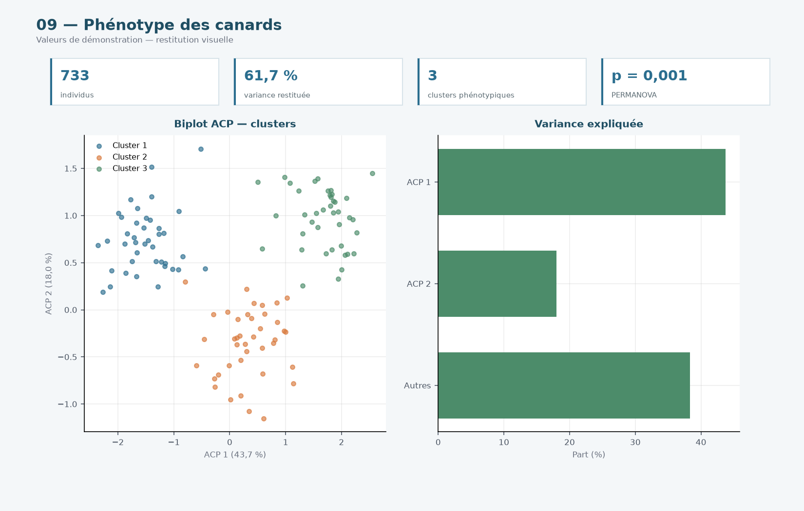

> **Besoin** : Comment la zone géographique et le sexe structurent-ils la variabilité morphométrique et phénotypique d'une population de canards domestiques ?  
> **Décision éclairée** : Identifier les clusters phénotypiques et quantifier l'effet de la zone et du sexe.

| | |
|---|---|
| **Domaine** | génétique animale, morphométrie, analyse multivariée |
| **Échantillon** | 733 individus, 23 paramètres quantitatifs et 12 variables qualitatives |
| **Outils** | R 4.6.0 (`tidyverse`, ACP, ACM, CAH, PERMANOVA) |
| **Méthodes clés** | CCI, ACP, ACM, CAH, PERMANOVA, Monte-Carlo |

::: {.brief}
**En bref**

- **Question** : Comment la zone géographique et le sexe structurent-ils la variabilité morphométrique et phénotypique d'une population de canards domestiques ?
- **Méthodes** : CCI, ACP, ACM, CAH, PERMANOVA, Monte-Carlo
- **Livrable** : Rapport détaillé anonymisé et tableau de bord
- **Résultat clé** : 17 des 23 paramètres initiaux présentent des biais inter-communes ; 6 variables robustes ont été retenues.
:::

## Données

733 individus, 23 paramètres squelettiques et pondéraux, 12 variables qualitatives de plumage et pigmentation. Données confidentielles.

## Démarche statistique

1. Diagnostic de comparabilité inter-communes : rapports de médianes et corrélations intraclasses (CCI) pour détecter les biais de mesure.
2. Sélection d'un noyau de variables robustes après exclusion des paramètres instables.
3. ACP sur les variables quantitatives standardisées ; ACM sur les variables qualitatives.
4. CAH sur les coordonnées de l'ACM pour identifier des clusters phénotypiques.
5. PERMANOVA (Mesures ~ Zone × Sexe) sur matrice de distances euclidiennes.
6. Tableaux de contingence avec p-values simulées par Monte-Carlo (2 000 réplications) pour les faibles effectifs.

## Résultats

- 17 des 23 paramètres initiaux présentent des biais inter-communes ; 6 variables robustes ont été retenues.
- L'ACP sur le noyau harmonisé restitue 61,7 % de la variance (Axe 1 : 43,7 % ; Axe 2 : 18,0 %).
- L'ACM révèle trois clusters phénotypiques confirmés par la CAH.
- La zone géographique est le facteur structurant majeur (p < 0,001 pour la quasi-totalité des variables qualitatives), le sexe étant le premier facteur de différenciation morphologique.
- La PERMANOVA confirme la significativité des effets principaux et de l'interaction Zone × Sexe (p = 0,001).

*Graphiques, dendrogrammes et tableaux détaillés non publiés ici.*

## Limites

- Graphiques et tableaux non publiés ; biais de mesure inter-communes partiellement corrigé.

## Interprétation

L'analyse illustre un pipeline multivarié complet : **contrôle qualité → réduction de dimension → classification → validation par permutations**. Elle permet de passer d'un grand nombre de mesures à une structuration biologique interprétable.

  ← <a href="../08-eco-epidemiologie-tiques/index.qmd">Étude précédente</a>
  <a href="../../etudes.qmd">Retour à la liste</a>
  <a href="../10-mensurations-tests-non-parametriques/index.qmd">Étude suivante</a> →

