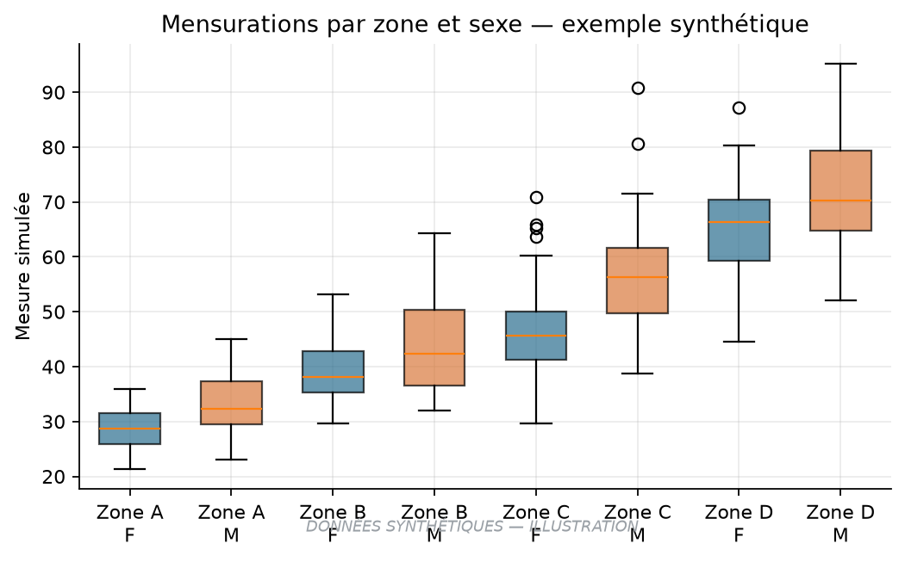

> **Besoin** : Comment comparer les mensurations corporelles de canards domestiques entre zones géographiques, selon le sexe et selon l'interaction Zone × Sexe, lorsque la normalité est rejetée ?  
> **Décision éclairée** : Comparer les mensurations entre zones et sexes malgré la non-normalité des données.

| | |
|---|---|
| **Domaine** | morphométrie, statistiques non paramétriques |
| **Échantillon** | Plus de 700 individus mesurés |
| **Outils** | R 4.6.0 (`tidyverse`, `readxl`, `broom`, `officer`, `flextable`) |
| **Méthodes clés** | Shapiro-Wilk, Kruskal-Wallis, Mann-Whitney, outliers |

## Données

Plus de 700 individus mesurés. Données de terrain confidentielles, non publiées ici.

## Démarche statistique

1. Détection stricte des valeurs aberrantes par la règle des quartiles (Q1 - 1,5 × IQR ; Q3 + 1,5 × IQR), par zone, sans imputation artificielle.
2. Test de Shapiro-Wilk : normalité rejetée.
3. Description par médianes et écarts interquartiles [Q1 ; Q3].
4. Test de Kruskal-Wallis pour les facteurs à plus de deux modalités (Zone, Zone × Sexe).
5. Test de Wilcoxon-Mann-Whitney pour le facteur Sexe (deux modalités).
6. Comparaisons multiples avec seuil α = 0,05.

## Résultats (synthèse anonymisée)

- Les variables morphométriques ne suivent pas une distribution normale.
- Les médianes assorties de lettres différentes indiquent des différences significatives au seuil de 5 %.
- Le test de Kruskal-Wallis met en évidence des variations significatives selon la zone et l'interaction Zone × Sexe.
- Le test de Mann-Whitney révèle un dimorphisme sexuel significatif sur les mensurations.

*Tableaux détaillés non publiés ici.*

*Figure illustrative générée à partir de données synthétiques. Elle ne représente pas les données de l'étude.*

## Limites

- Tableaux détaillés non publiés ; valeurs aberrantes traitées sans imputation.

## Interprétation

Ce cas illustre la **transition du descriptif paramétrique vers des tests de rang robustes**, avec un traitement explicite des outliers et une restitution lisible des comparaisons multiples — trois points critiques en biostatistique appliquée.
