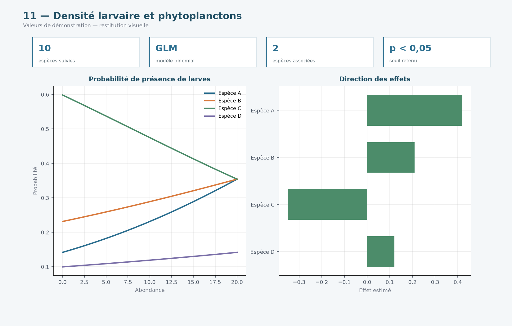

> **Besoin** : L'abondance de différentes espèces de phytoplanctons dans les points d'eau est-elle associée à la présence de larves d'*Anopheles gambiae* ?  
> **Décision éclairée** : Identifier les espèces associées à la présence de larves pour guider la surveillance.

| | |
|---|---|
| **Domaine** | écologie, modélisation épidémiologique |
| **Échantillon** | Points d'eau avec abondances de dix espèces de phytoplanctons |
| **Outils** | R (`glm`, `ggplot2`) |
| **Méthodes clés** | GLM binomial, courbes de prédiction |

::: {.brief}
**En bref**

- **Question** : L'abondance de différentes espèces de phytoplanctons dans les points d'eau est-elle associée à la présence de larves d'*Anopheles gambiae* ?
- **Méthodes** : GLM binomial, courbes de prédiction
- **Livrable** : Rapport détaillé anonymisé et tableau de bord
- **Résultat clé** : L'abondance de *Kirchneriella* est associée à une augmentation marquée de la probabilité de présence de larves.
:::

## Données

Abondances de dix espèces de phytoplanctons et statut de présence/absence de larves. Données de terrain confidentielles.

## Démarche statistique

1. Modèle de régression logistique généralisée (famille binomiale, lien logit) avec `glm()`.
2. Variable réponse binaire : présence = 1, absence = 0.
3. Variables explicatives : abondances des dix espèces de phytoplanctons.
4. Génération de jeux de données hypothétiques (`newdata`) en faisant varier chaque espèce de son minimum à son maximum, les autres étant fixées à leur moyenne.
5. Visualisation des courbes de probabilité facettées avec `ggplot2`.

## Résultats

- L'abondance de *Kirchneriella* est associée à une augmentation marquée de la probabilité de présence de larves.
- À l'inverse, *Scenedesmus quadricauda* montre une relation décroissante avec cette probabilité.
- Les courbes facettées permettent de comparer visuellement l'effet de chaque espèce à abondance croissante.

*Figures et coefficients détaillés non publiés ici.*

## Limites

- Figures et coefficients non publiés ; association observée, causalité non établie.

## Interprétation

La modélisation GLM transforme des comptages écologiques en **probabilités de présence**, plus faciles à communiquer. L'approche par courbes de prédiction rend les effets de chaque espèce lisibles sans exposer les données brutes.

  ← <a href="../10-mensurations-tests-non-parametriques/index.qmd">Étude précédente</a>
  <a href="../../etudes.qmd">Retour à la liste</a>
  <a href="../12-plantes-medicinales-menopause/index.qmd">Étude suivante</a> →

