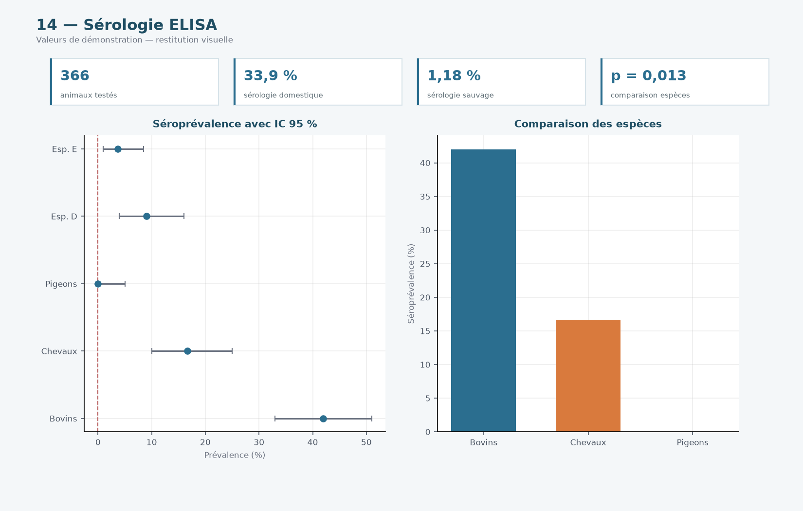

> **Besoin** : Quelle est la séroprévalence observée chez les animaux sauvages et domestiques, et quels facteurs (espèce, site, sexe, âge) sont associés à la positivité ?  
> **Décision éclairée** : Hiérarchiser les espèces et les sites à risque pour la surveillance vétérinaire.

| | |
|---|---|
| **Domaine** | épidémiologie vétérinaire, sérologie |
| **Échantillon** | 254 animaux sauvages et 112 animaux domestiques testés par ELISA |
| **Outils** | R (`prop.test`, `fisher.test`) |
| **Méthodes clés** | `prop.test`, Fisher, odds ratios, IC 95 % |

## Données

254 animaux sauvages et 112 animaux domestiques testés par ELISA. Données confidentielles, non publiées ici.

## Démarche statistique

1. Calcul des séroprévalences avec intervalles de confiance à 95 % (`prop.test`).
2. Comparaison des proportions par espèce, site, sexe et classe d'âge.
3. Test exact de Fisher (`fisher.test`) pour les tableaux 2 × 2 et calcul des odds ratios avec IC 95 %.

## Résultats

- Chez les animaux sauvages : 1,18 % de séropositifs (3/254), avec des prévalences plus élevées chez deux espèces (3,7 % et 5,88 %).
- Chez les animaux domestiques : 33,93 % de séropositifs (38/112) ; la séroprévalence bovine (41,98 %) dépasse celle des chevaux (16,67 %, p = 0,013) et des pigeons (0 %, p = 0,016).
- Chez les bovins, une commune affiche 64,71 % contre 16,67 % dans une autre (p = 0,03) ; les femelles sont plus touchées (70,59 % vs 29,41 %, p < 0,001).
- Certaines comparaisons conduisent à un odds ratio infini, indiquant une association très forte entre exposition et résultat.

*Tableaux détaillés non publiés ici.*

## Limites

- Tableaux détaillés non publiés ; odds ratios infinis sur certaines comparaisons à faibles effectifs.

## Interprétation

Le couplage `prop.test` / `fisher.test` fournit un cadre complet : **estimation avec incertitude** puis **test d'association**. Il permet de hiérarchiser les espèces et les sites à risque malgré des effectifs parfois faibles.
