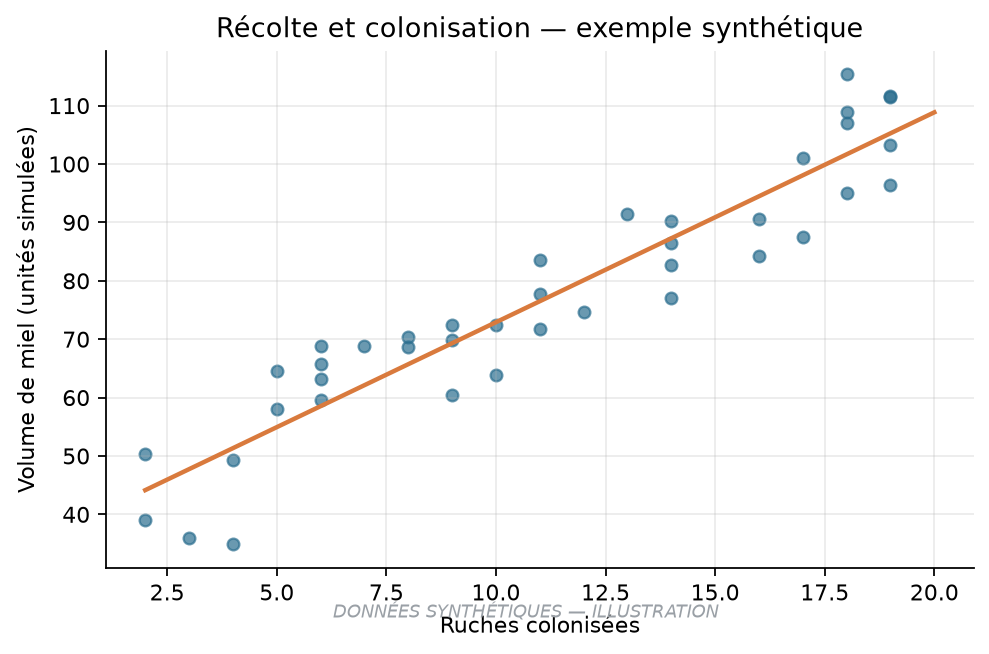

> **Besoin** : Quelle est la diversité des plantes mellifères d'une arrondissement, quelles espèces sont les plus exploitées par les abeilles, et comment la production de miel varie-t-elle avec le nombre de ruches ?  
> **Décision éclairée** : Choisir les espèces à privilégier dans les plantations et estimer le lien colonisation/récolte.

| | |
|---|---|
| **Domaine** | apiculture, écologie, statistiques descriptives et régression |
| **Échantillon** | 68 espèces mellifères, 30 apiculteurs, 10 séquences de butinage |
| **Outils** | R, indices de diversité, régression linéaire |
| **Méthodes clés** | Shannon, fréquence de citation, régression linéaire |

## Données

68 espèces mellifères recensées (62 genres, 29 familles), 30 apiculteurs interrogés, 10 séquences de butinage et relevés de floraison. Données confidentielles.

## Démarche statistique

1. Richesse spécifique et indice de Shannon-Wiener (H', Hg) avec équitabilité de Piélou.
2. Fréquence de citation des espèces par les apiculteurs.
3. Analyse des types biologiques et des classes de floraison.
4. Suivi du ratio abeilles/fleurs près du rucher et à distance, sur deux cultures.
5. Régression linéaire du volume de miel récolté selon le nombre de ruches colonisées.

## Résultats (synthèse anonymisée)

- Indice de Shannon global H = 3,195 (genres : 3,004), équitabilité J = 0,81 : flore riche et équilibrée.
- Cinq espèces stratégiques dépassent 83 % de citation ; 16 des 27 espèces citées ont une valeur apicole importante (F > 50 %).
- La floraison longue domine (38 espèces, 55,88 %), concentrée sur trois mois.
- La fréquentation des fleurs est 2,6 à 3,4 fois supérieure à proximité du rucher selon la culture.
- Le temps passé par fleur diminue lorsque la séquence de butinage s'allonge (4,46 s vs 3,20 s).
- Rendement moyen : 5,84 L par ruche ; modèle L = 36,6 + 3,72 × (nombre de ruches), r = 0,78, R² = 0,61, p < 0,001.

*Limites : échantillon restreint, une seule saison, deux cultures étudiées.*

*Figure illustrative générée à partir de données synthétiques. Elle ne représente pas les données de l'étude.*

## Limites

- Échantillon restreint, une seule saison, deux cultures étudiées.

## Interprétation

Le projet combine **biodiversité**, **comportement de butinage** et **performance économique**. Les résultats identifient les espèces à privilégier dans les plantations et quantifient le lien entre colonisation des ruches et récolte.
